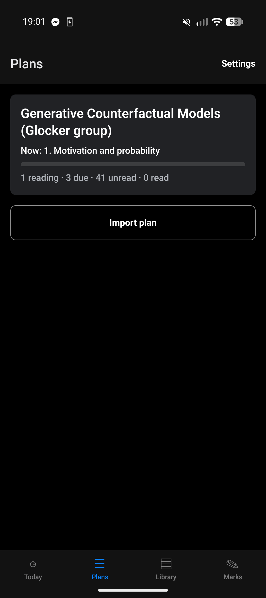
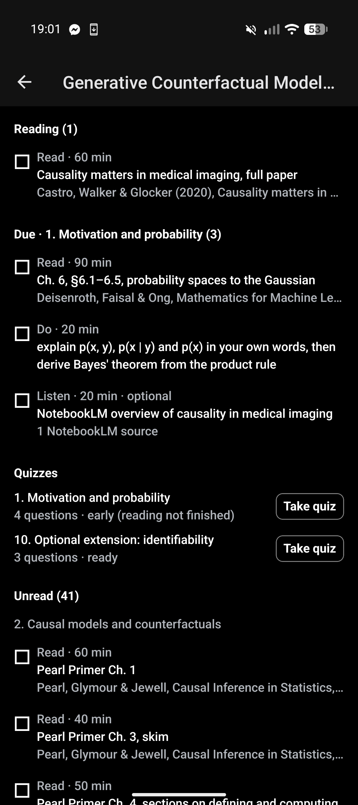
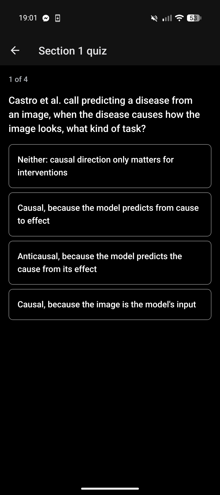
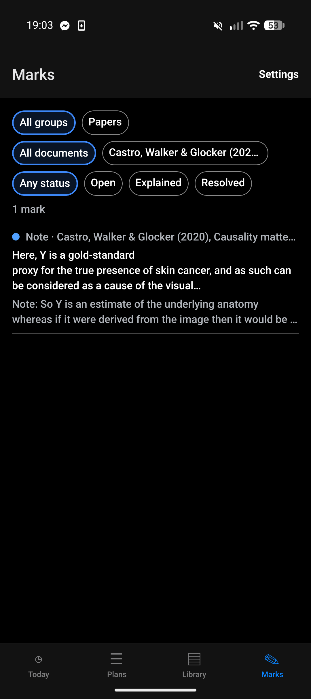
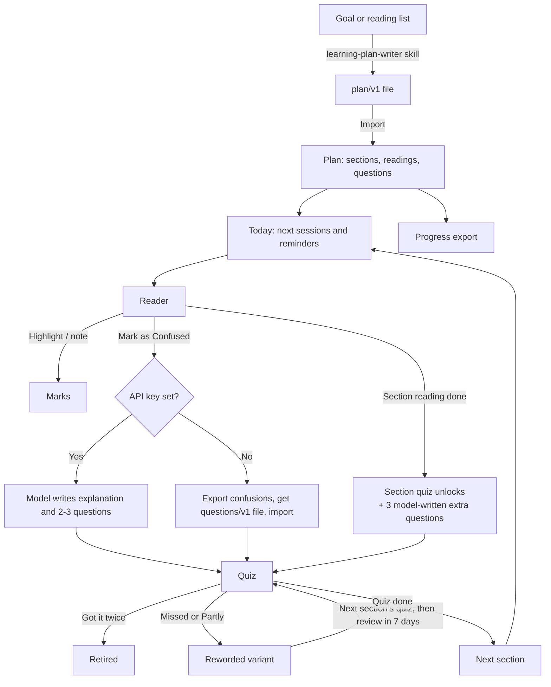
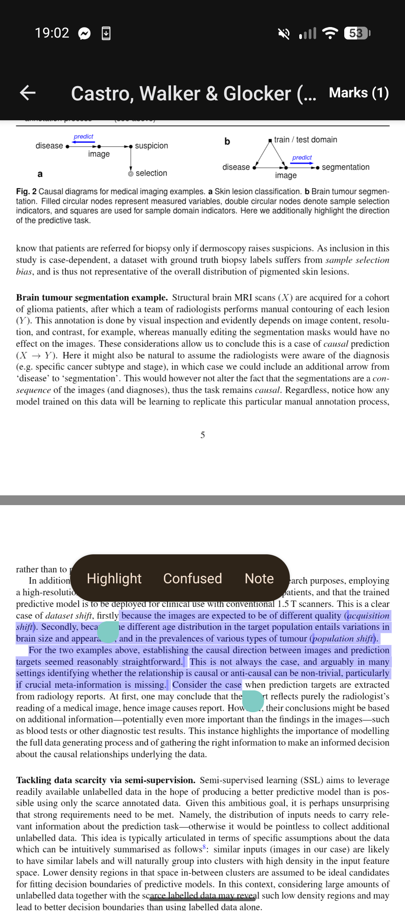

# PaperReaderApp

I found that I have lots of pockets of free time between activities where I could be reading or learning a small amount. I wanted a system which is low friction (works on my phone) and integrates with my agents so I can easily define a syllabus based on my weak points. The agents will take into account the things you've marked as 'confusing' and alter their quiz questions around these. 

I use Claude to generate the reading plan and then I use an API key to use smaller cheaper models for the question generation. I might experiment with how much context/model capacity is required for good questions in the future. 

**Read papers on a plan, mark what confuses you, get quizzed until it sticks.**

An Android app for working through textbooks and papers section by section. Import a reading plan, read the PDFs in the app, and take a quiz at the end of each section. Passages you mark as confusing come back as explanations and questions.

<p align="center">
  
  
  
  
</p>

## How it works



## Features

### Plans


Import a `plan/v1` markdown file listing the documents, each section's reading with page ranges, and quiz questions. Run several plans at once. Each plan shows what you're reading, what's due and what's done, with progress and reading time per section.

<br clear="right">

### Today
Your next focus and listening sessions for each plan. Set time slots and get notifications with Start, Snooze and Skip. Missed sessions roll forward instead of piling up. No slots? It just lists what's next.

<br clear="right">

### Reader


A pdf.js reader that opens where you left off. Highlight, add notes, or mark a passage as **Confused**. Reading time is logged per document.

<br clear="right">

### Quizzes


Each section's quiz unlocks when its reading is done. Questions are multiple choice or open with self-grading, and each answer links to its page. Wrong answers come back in the next section's quiz and again a week later until you get them right twice.

<br clear="right">

### Confusions


Every confused passage gets an explanation and a few questions, which go to the front of your next quiz. When you've answered them all correctly twice, the confusion is resolved. The **Marks** tab lists all highlights, notes and confusions, filtered by document and status.

<br clear="right">

### Optional model integration

Add a key for an OpenAI-compatible endpoint in **Settings** and the app will:

- explain confused passages and write questions about them;
- write 3 extra questions per section from the pages you read;
- reword questions you got wrong, so the retry tests understanding rather than memory.

The key stays on the phone (`expo-secure-store`), every request is logged with an estimated cost, and you get a notification every £5. Without a key, the same loop runs through markdown export and import.

## Writing plans with Claude

[`skills/learning-plan-writer`](skills/learning-plan-writer) is a Claude skill that turns a goal or reading list into an importable plan, with real PDF page ranges and quiz questions. Example output: [`plans/counterfactual-models.plan.md`](plans/counterfactual-models.plan.md).

## Development

```bash
npm install
npx jest               # tests
npx tsc --noEmit       # typecheck
npx expo lint          # lint
npm run build:viewer   # rebuild the PDF viewer after editing src/lib/reader
```

The built viewer is committed, so a fresh clone runs without `build:viewer`.

### Build and ship

Uses [EAS](https://docs.expo.dev/eas/). For your own Expo account, change `owner` and `extra.eas.projectId` in `app.json` or run `npx eas-cli init`.

```bash
npx eas-cli build --platform android --profile preview   # APK, only when native modules change
npx eas-cli update --branch preview --environment preview --message "..."   # JS updates
```

Installed apps pick up updates from **Settings → Check for update**.

## Licence

MIT
